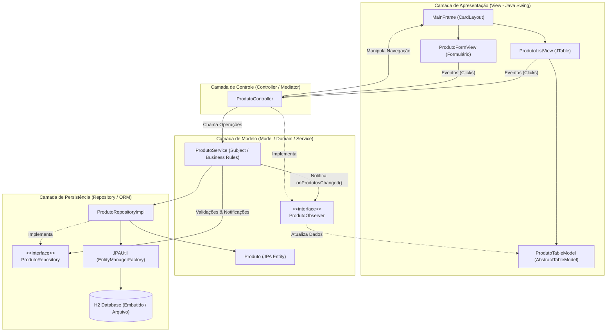
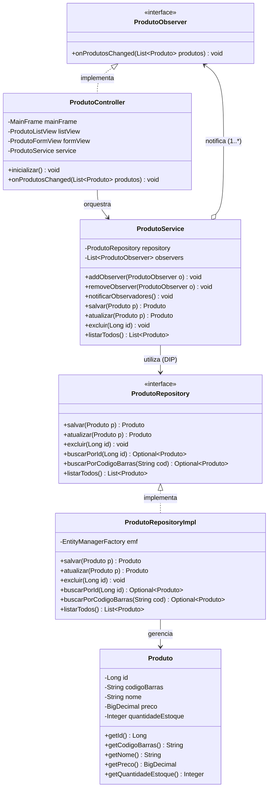

# PDV-Swing-JPA: Gestão de Produtos para Ponto de Venda

> **Projeto Didático Completo de Referência para Ensino Superior e Concurso Público FATEC**  
> **Disciplina:** Técnicas de Programação II  
> **Tema Central:** Arquitetura MVC, Mapeamento Objeto-Relacional (JPA/Hibernate), Padrões GoF (Observer, Repository, Factory) e Interface Gráfica Java Swing.

---

## 1. Visão Geral e Contexto Pedagógico

Este projeto foi concebido para servir como **referência metodológica e prática** para aulas de ensino superior e bancas examinadoras de **Concursos Públicos para Professor do Centro Paula Souza (FATEC)**.

### Objetivos Pedagógicos da Aplicação
1. **Desmistificar a Camada de Apresentação Desktop (Java Swing):** Superar o código acoplado comumente gerado por assistentes visuais (ex.: NetBeans GUI Builder), ensinando a estruturar interfaces limpas e reativas em código puro.
2. **Implementar MVC Verdadeiro:** Garantir que a Visão (`View`) desconheça regras de negócio e consultas a banco de dados, atuando apenas como consumidora de eventos coordenados pelo Controlador (`Controller`).
3. **Compreender o Mapeamento Objeto-Relacional (ORM) na Prática:** Demonstrar como a especificação **Jakarta Persistence (JPA 3.1)** e o provedor **Hibernate 6.x** eliminam a complexidade do *Impedance Mismatch* e substituem o SQL procedural por entidades ricas orientadas a objetos.
4. **Dominar Padrões de Projeto (GoF & Martin Fowler):**
   - **Observer Pattern:** Sincronização reativa e desacoplada entre mutações do modelo e a tabela da interface gráfica.
   - **Repository Pattern:** Abstração completa do mecanismo de persistência e suporte a testes automatizados.
   - **Inversion of Control (IoC) / Dependency Injection:** Injeção explícita de dependências sem necessidade de containers pesados.
   - **Thread Safety no Swing (Event Dispatch Thread - EDT):** Garantia de concorrência segura com `SwingUtilities.invokeLater(...)`.

---

## 2. Diagramas Arquiteturais (Mermaid)

### 2.1. Visão Geral da Arquitetura em Camadas (MVC Puro)



---

### 2.2. Diagrama de Sequência: Fluxo "Salvar Produto"

O diagrama a seguir detalha o ciclo de vida completo do cadastro de um produto, desde a interação do usuário na interface gráfica até a persistência no banco e a atualização reativa da tabela:

```mermaid
    sequenceDiagram
        autonumber
        actor Usuario as Usuário (Operador)
        participant Form as ProdutoFormView
        participant Ctrl as ProdutoController
        participant Svc as ProdutoService
        participant Repo as ProdutoRepositoryImpl
        participant JPA as EntityManager / H2
        participant List as ProdutoListView / TableModel

        Usuario->>Form: Clica em "Salvar Produto"
        Form->>Ctrl: Dispara ActionListener (btnSalvar)
        Ctrl->>Form: Coleta dados (código de barras, nome, preço, estoque)
        Ctrl->>Ctrl: Valida conversão numérica (BigDecimal / Integer)
        
        Ctrl->>Svc: salvar(novoProduto)
        Note over Svc: Valida Regras de Negócio:<br/>- Campos não vazios<br/>- Preço positivo (&gt; 0)<br/>- Estoque não negativo (&gt;= 0)<br/>- Unicidade do código de barras
        
        Svc->>Repo: salvar(produto)
        Repo->>JPA: em.getTransaction().begin()
        Repo->>JPA: em.persist(produto)
        Repo->>JPA: em.getTransaction().commit()
        JPA-->>Repo: Produto com ID gerado (Identity)
        Repo-->>Svc: Retorna produto persistido
        
        Note over Svc: Padrão Observer Disparado:<br/>Thread-Safe via SwingUtilities.invokeLater
        Svc->>Ctrl: onProdutosChanged(listaAtualizada)
        Ctrl->>List: atualizarTabela(listaAtualizada)
        List-->>Usuario: JTable repintada e atualizada na tela!
        Ctrl->>Form: Exibe JOptionPane ("Produto cadastrado com sucesso!")
        Ctrl->>Form: Alterna CardLayout para tela de Listagem
```

---

### 2.3. Diagrama de Classes: Padrões Repository & Observer



---

## 3. Justificativa Pedagógica do Stack Tecnológico

| Tecnologia / Decisão | Justificativa Didática |
| :--- | :--- |
| **Java 17+ (LTS)** | Linguagem padrão de mercado em instituições de ensino, oferecendo recursos modernos (Records, Switch Expressions, Pattern Matching, Text Blocks) e máxima estabilidade. |
| **Jakarta Persistence (JPA 3.1) & Hibernate 6.x** | Demonstra a separação fundamental entre **especificação padrão** (`jakarta.persistence.*`) e **provedor de implementação** (`org.hibernate.*`). Ensina aos alunos o paradigma ORM, ciclo de vida de entidades (*transient, managed, detached*), mapeamento de constraints e transações atômicas ACID sem acoplamento a SQL proprietário. |
| **H2 Database (Embutido / Arquivo)** | **Zero-Configuration:** Não exige a instalação prévia de servidores externos como MySQL, PostgreSQL ou Docker, garantindo que qualquer aluno ou membro de banca examinadora execute o projeto em segundos. Os dados são persistidos de forma duradoura no arquivo local `./data/pdv_db.mv.db`. |
| **Java Swing (Código Puro)** | Permite ao professor demonstrar o funcionamento interno de containers (`JFrame`, `JPanel`), gerenciadores de layout (`CardLayout`, `GridBagLayout`, `BorderLayout`), e o tratamento rigoroso de concorrência com a **EDT (Event Dispatch Thread)**. |
| **FlatLaf Look & Feel** | Fornece acabamento visual moderno, elegante e de nível profissional à aplicação desktop, superando a aparência legada do visual padrão clássico do Java. |
| **Maven Wrapper (`mvnw` / `mvnw.cmd`)** | Garante reproducibilidade total do build em qualquer ambiente Windows, Linux ou macOS, eliminando o clássico problema de "não tenho o Maven configurado nas variáveis de ambiente". |

---

## 4. Estrutura do Projeto

```text
exemplo_persistencia_JavaSwing/
├── .mvn/wrapper/                 # Binários e configuração do Maven Wrapper
├── data/                         # Arquivos de banco de dados H2 gerados em tempo de execução
├── src/
│   ├── main/
│   │   ├── java/br/gov/sp/cps/fatec/pdv/
│   │   │   ├── Main.java                        # Ponto de entrada (Bootstrap, Pure DI e Look&Feel)
│   │   │   ├── controller/
│   │   │   │   └── ProdutoController.java       # Orquestrador MVC e ouvinte Observer
│   │   │   ├── model/
│   │   │   │   ├── entity/
│   │   │   │   │   └── Produto.java             # Entidade JPA mapeada para tabela 'produtos'
│   │   │   │   ├── observer/
│   │   │   │   │   └── ProdutoObserver.java     # Interface funcional do padrão Observer
│   │   │   │   ├── repository/
│   │   │   │   │   ├── ProdutoRepository.java   # Abstração de persistência (Interface)
│   │   │   │   │   └── ProdutoRepositoryImpl.java # Implementação com JPA / EntityManager
│   │   │   │   └── service/
│   │   │   │       └── ProdutoService.java      # Regras de negócio, unicidade e Subject Observer
│   │   │   ├── util/
│   │   │   │   └── JPAUtil.java                 # Gerenciador Singleton do EntityManagerFactory
│   │   │   └── view/
│   │   │       ├── MainFrame.java               # Janela com CardLayout para alternância de telas
│   │   │       ├── ProdutoFormView.java         # Formulário de cadastro/edição com GridBagLayout
│   │   │       ├── ProdutoListView.java         # Tabela de dados com JTable e ações CRUD
│   │   │       └── tablemodel/
│   │   │           └── ProdutoTableModel.java   # Modelo de tabela reativo (AbstractTableModel)
│   │   └── resources/
│   │       └── META-INF/
│   │           └── persistence.xml              # Configuração JPA para banco H2 e testes
│   └── test/java/br/gov/sp/cps/fatec/pdv/
│       ├── model/repository/
│       │   └── ProdutoRepositoryTest.java       # Teste unitário/integrado do repositório
│       └── model/service/
│           └── ProdutoServiceTest.java          # Teste de validações de negócio e Observer
├── pom.xml                                      # Descritor do Maven e dependências
├── mvnw / mvnw.cmd                              # Scripts executáveis do Maven Wrapper
└── README.md                                    # Esta documentação didática
```

---

## 5. Como Compilar e Executar

### Pré-requisitos
- **Java JDK 17** ou superior instalado (`java -version`).
- Não é obrigatório possuir Maven instalado no sistema operacional, pois o projeto acompanha o **Maven Wrapper**.

### 5.1. Execução via Maven Wrapper (Modo Desenvolvimento)

No terminal (PowerShell, Prompt de Comando ou Bash), na raiz do projeto:

#### No Windows (PowerShell / CMD):
```powershell
# Executar a aplicação diretamente pelo Maven:
.\mvnw.cmd compile exec:java -Dexec.mainClass="br.gov.sp.cps.fatec.pdv.Main"
```

#### No Linux / macOS:
```bash
./mvnw compile exec:java -Dexec.mainClass="br.gov.sp.cps.fatec.pdv.Main"
```

---

### 5.2. Compilação, Testes e Geração do Pacote JAR (Produção)

Para rodar a suíte completa de testes automatizados e empacotar o executável com todas as dependências em `target/lib/`:

```powershell
# Compilar, testar e empacotar:
.\mvnw.cmd clean package
```

Após o build com sucesso (`BUILD SUCCESS`), execute o arquivo JAR gerado:

```powershell
# Execução direta do executável empacotado:
java -jar target/exemplo_persistencia_JavaSwing-1.0.0.jar
```

---

### 5.3. Execução Direta via IDE (VS Code, IntelliJ IDEA, Eclipse ou NetBeans)
1. Abra a pasta do projeto como um projeto Maven existente na sua IDE preferida.
2. Aguarde a sincronização das dependências do `pom.xml`.
3. Navegue até o arquivo `src/main/java/br/gov/sp/cps/fatec/pdv/Main.java`.
4. Clique com o botão direito e selecione **Run 'Main.main()'**.

---

## 6. Roteiro Pedagógico Sugerido para Aula Teste (Concurso Público FATEC)

Este roteiro foi estruturado para uma aula didática de 30 a 50 minutos perante a Banca Examinadora:

| Tempo | Etapa da Aula | Conteúdo e Argumentação Didática |
| :---: | :--- | :--- |
| **00 - 05 min** | **Contextualização e Problematização** | Apresentação do problema de negócio (Módulo PDV). Demonstração dos vícios comuns de desenvolvimento desktop: mistura de código SQL dentro do evento de clique de botão (`JButton`), acoplamento rígido e interfaces que travam por falta de gerenciamento de threads. |
| **05 - 15 min** | **Arquitetura MVC & Padrões GoF** | Apresentação do diagrama arquitetural. Explicação da **Inversão de Dependência (DIP)**: por que o Controller e o Service conhecem apenas a interface `ProdutoRepository`. Apresentação do padrão **Observer**: por que o Model deve apenas notificar e não conhecer quem o desenha. |
| **15 - 25 min** | **Mapeamento Objeto-Relacional (JPA/Hibernate)** | Inspeção da classe `Produto` anotada com JPA. Explicação do `EntityManagerFactory` (Singleton no `JPAUtil`) vs `EntityManager` (Unit of Work). Apresentação da demarcação transacional atômica (`begin()`, `commit()`, `rollback()`) no `ProdutoRepositoryImpl`. |
| **25 - 35 min** | **Demonstração Prática do Software** | Execução ao vivo do sistema. Cadastrar um produto novo $\rightarrow$ mostrar o insert gerado nos logs do Hibernate $\rightarrow$ observar a tabela sendo atualizada via Observer $\rightarrow$ testar validações (preço negativo, código duplicado) $\rightarrow$ editar registro $\rightarrow$ excluir com diálogo de confirmação. |
| **35 - 45 min** | **Thread Safety & Boas Práticas** | Explicação detalhada da **Event Dispatch Thread (EDT)** do Swing e o uso do `SwingUtilities.invokeLater(...)`. Exibição da execução dos testes unitários no H2 em memória (`mvn test`). |
| **45 - 50 min** | **Conclusão e Fechamento** | Síntese dos objetivos pedagógicos alcançados e abertura para perguntas e arguição da banca examinadora. |

---

## 7. Histórico de Versões e Gitflow

O repositório foi construído seguindo rigorosamente o modelo **Gitflow** e **Conventional Commits**:

- `main`: Branch estável com a versão pronta para demonstração e produção.
- `develop`: Branch de integração contínua das funcionalidades.
- `feature/setup-and-persistence`: Configuração Maven, JPA Hibernate 6, H2 Database, Entidade `Produto`, Repositório e testes unitários.
- `feature/views-and-tablemodel`: Construção dos componentes visuais Swing (`ProdutoTableModel`, `ProdutoFormView`, `ProdutoListView`, `MainFrame`).
- `feature/controller-and-observer`: Implementação da lógica de orquestração do `ProdutoController`, serviço de validações `ProdutoService` e sincronização via `ProdutoObserver`.
- `docs/didactic-documentation`: Elaboração completa da documentação pedagógica, diagramas Mermaid e roteiro de aula para concurso.

---

**Centro Estadual de Educação Tecnológica Paula Souza - FATEC**  
*Técnicas de Programação II | Prof. Caína Antunes*
